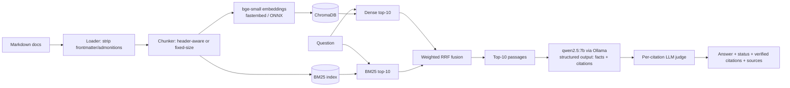
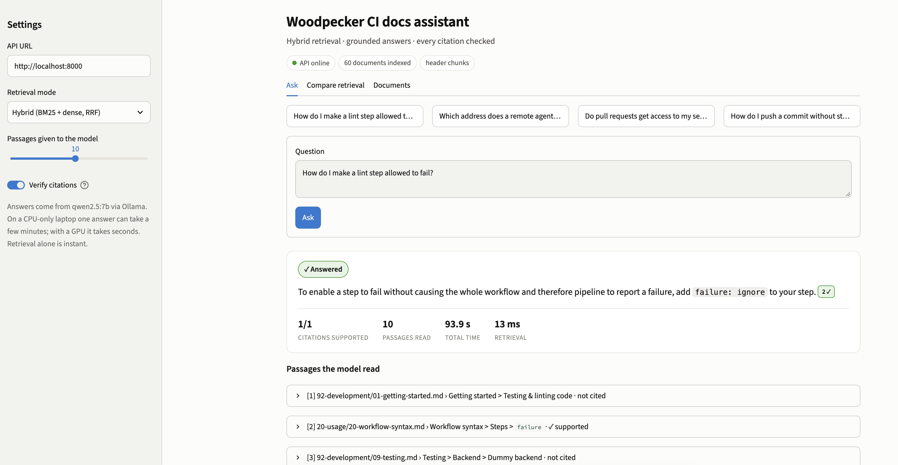
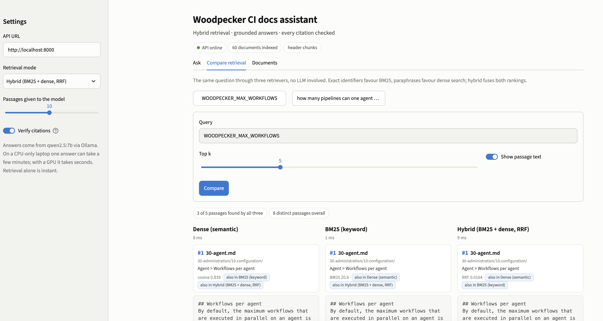
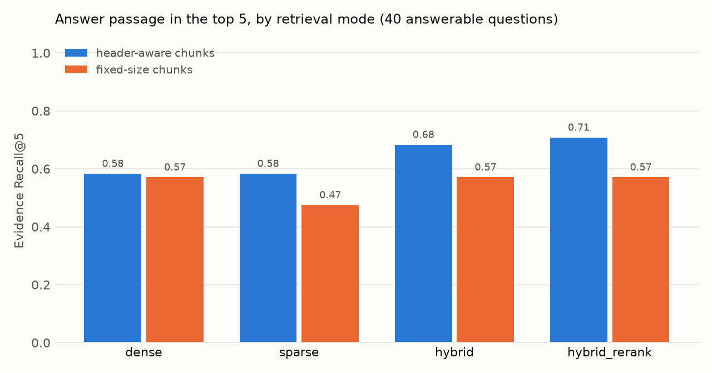
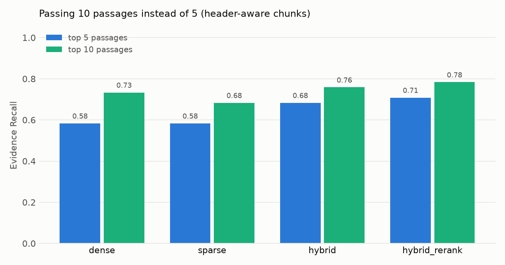
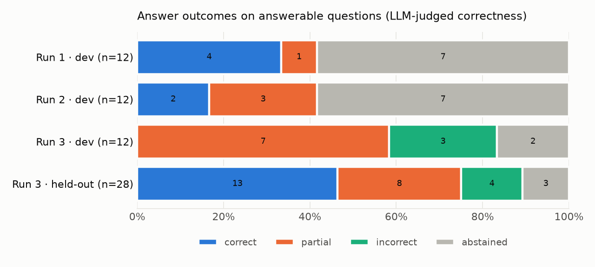

# Hybrid-Search RAG over Technical Documentation

Ask questions about a real open-source project's documentation and get answers with
**verified citations**. The system combines keyword (BM25) and semantic (dense vector)
search, generates answers with a local LLM, and checks every citation with an LLM judge.
Everything runs on free tools: local embeddings, a local 7B model via Ollama, and a free
Colab GPU for the evaluation runs.

**Key results** on a 50-question evaluation set (details and caveats below):

- **Hybrid search finds the answer passage more often than either search alone:** evidence
  Recall@5 of 0.68, vs 0.58 for dense-only and 0.58 for BM25-only (header-aware chunks,
  40 answerable questions).
- **9 of 10 unanswerable questions were correctly refused.**
- **83% of citations were judged to support their sentence.** A second model agreed with
  the judge on 20 of 20 sampled verdicts.
- **35 of 40 answerable questions were answered, but only 13 fully correctly** (15 partial,
  7 incorrect, LLM-judged). Answer completeness is the main weakness.

> **Status: portfolio MVP.** This is a measured local prototype, not a production
> service: there is no auth, no scaling, and no deployment beyond Docker.

---

## Problem

Internal documentation answers most engineering questions, but only if you can find the
right passage. Pure semantic search misses exact identifiers (`WOODPECKER_MAX_WORKFLOWS`,
error strings), and pure keyword search misses paraphrased questions. An LLM can
summarise what it finds, but it will also invent plausible details. This project
measures how far a small, free stack gets on both problems:

1. Does hybrid retrieval actually beat either method alone?
2. Can answers be grounded and checked well enough to show users which claims are backed
   by which passage?

**Corpus:** the [Woodpecker CI](https://github.com/woodpecker-ci/woodpecker) documentation
(Apache-2.0): 60 Markdown files, about 41k words, pinned at commit `fd00b3d`. It's a niche
project, so the LLM is less likely to know the answers from training, and the docs are
full of config keys, which is exactly where keyword search matters.

## What I built



| Component | Implementation | Why |
|---|---|---|
| Ingestion | `documents.py`, `chunking.py` | Header-aware chunks keep each section intact and carry the heading path. Headings inside code blocks are ignored, and tiny parent-only sections are merged. |
| Indexing | `indexing.py` | Dense and BM25 indexes are built from **one** chunk list, and a fingerprint check fails the build if they drift. The BM25 tokenizer keeps `SNAKE_CASE` keys whole and also splits them into parts. |
| Retrieval | `retrieval.py` | Dense, BM25, weighted RRF (rank-based, so no score scaling is needed), and an optional cross-encoder reranker. |
| Generation | `generation.py`, `pipeline.py` | The model outputs fact sentences, each with its own citation list. **Code**, not the model, derives answered / partial / insufficient from that output. |
| Verification | `verification.py` | One yes/no judge call per (sentence, passage) pair. A failed judgment is reported as missing, never as "unsupported". |
| Evaluation | `evaluation.py`, `eval_*.py`, `hand_check.py` | Evidence-level retrieval metrics, generation metrics split into dev and held-out, resumable runs, and judge cross-checking. |
| Serving | `api.py`, `Dockerfile` | FastAPI: `POST /v1/ask`, `POST /v1/search` (retrieval only), `GET /v1/documents`, `POST /v1/ingest`, plus OpenAPI docs at `/docs`. |
| UI | `app/streamlit_app.py` | Streamlit client of the API: answers with per-citation ✓/✗ chips and the passages behind them, a side-by-side dense / BM25 / hybrid comparison, and document ingest. |

**Tech stack:** Python 3.11+, fastembed (`BAAI/bge-small-en-v1.5`, quantized ONNX,
384-d), ChromaDB (embedded), rank-bm25, Ollama `qwen2.5:7b`, FastAPI, Streamlit, Docker,
pytest + ruff, GitHub Actions.

### Demo UI



The **Ask** tab shows each answer sentence with chips for its cited passages: ✓ if the
judge found the passage supports the sentence, ✗ if not. Every passage the model read can
be expanded underneath.



**Compare retrieval** runs one query through dense, BM25 and hybrid search side by side
and marks which passages each method shares with the others. It needs no LLM, so it
responds instantly even on a laptop CPU.

## Results

All numbers come from committed files in `results/`. Charts are generated from those
files by `python -m hybrid_rag.figures`.

### Evaluation set

50 questions in `data/eval/golden.jsonl`:

- **Types:** 17 lookup, 13 config key, 10 multi-hop (the answer needs two or more files), and 10 with no answer in the docs.
- **Evidence:** each answerable source carries a verbatim **evidence phrase** from the docs, and the loader verifies it exists.
- **Dev split (15):** used while fixing the pipeline.
- **Held-out split (35):** written after the pipeline was frozen.
- **Authorship:** the questions were drafted with an LLM, and every answer was checked against its source passage. See the limitations section for what that implies.

### Retrieval: evidence Recall@5 (was the answer passage retrieved?)

A hit counts only if a retrieved chunk *contains the evidence phrase*. The lenient
alternative, "the right file was retrieved", overstated recall by 20–40 points in
early runs, because long files were "found" while the answer passage was not.



| Mode (40 answerable questions) | Header chunks @5 | @10 | Fixed chunks @5 | Latency/query (laptop CPU, range over runs) |
|---|---|---|---|---|
| Dense only | 0.583 | 0.733 | 0.571 | 9–36 ms |
| BM25 only | 0.583 | 0.683 | 0.475 | 2–9 ms |
| **Hybrid (RRF)** | **0.683** | **0.758** | 0.571 | 11–39 ms |
| Hybrid + cross-encoder rerank | 0.708 | 0.783 | 0.571 | 0.87–1.7 s |

- **Hybrid beats either method alone.** On the held-out split it scores 0.786 vs 0.679 for dense and 0.607 for BM25.
- **Header-aware chunking is never worse than fixed-size chunking,** and is clearly better for hybrid (0.68 vs 0.57). For dense the gap (0.583 vs 0.571) is within noise.
- **The reranker isn't used.** It adds 1 hit at 5 passages, adds nothing for fixed chunks, and costs about 90× the latency.



**Decision: pass 10 passages to the LLM, not 5.** Hybrid recall goes from 0.444 to 0.653 on
the dev set, where the decision was made, and from 0.683 to 0.758 on all 40 questions. It
was one change, made on data, and frozen afterwards.

### Generation (run 3, final, `results/run3/`)

| | All (50) | Held-out (35) | Dev (15) |
|---|---|---|---|
| Unanswerable questions correctly refused | 9/10 | 7/7 | 2/3 |
| Answerable questions answered (not refused) | 35/40 | 25/28 | 10/12 |
| …correct / partial / incorrect (LLM judge) | 13 / 15 / 7 | 13 / 8 / 4 | 0 / 7 / 3 |
| Citation precision (judge) | 0.83 | 0.85 | 0.80 |
| Sentences without a citation | 0 | 0 | 0 |
| Median latency per question (Colab T4 GPU, incl. verification) | 4.7 s | 4.5 s | 4.7 s |



**How far to trust the judge.** The judge is the same `qwen2.5:7b` model grading its own
output. To check it, a random sample (seed 0) of 30 verdicts (`results/run3/crosscheck_claude.csv`)
was re-labeled independently by **a second, stronger model (Claude)**:

- **Citation verdicts: 20/20 agreement,** including the 3 the judge rejected.
- **Correctness grades: 7/10 agreement,** with the disagreements going both ways.

This is a cross-model check, **not a human annotation**. `results/run3/hand_check.csv` is
a blank template for a human rater (`python -m hybrid_rag.hand_check score …`).

**Example of the verification catching a hallucination (q010).** The model answered that
`CI_PIPELINE_TAG` holds the git tag, and cited two passages. That variable appears nowhere
in the docs, and the judge marked both citations unsupported.

## Engineering decisions and what failed along the way

The generation layer went through three evaluation runs. Each change was driven by
failures found by inspecting the actual passages the model received.

| Run | Design | What the data showed | Change |
|---|---|---|---|
| 1 | Free-text answers with inline `[n]`, model sets an "insufficient" flag, 5 passages | 7/12 answerable dev questions refused. Correct answers had **no citations** or citations piled at the end. A verifier bug scored a cited, correct answer at 0% precision. | Per-sentence citation lists in structured output. Evidence-level retrieval metric. Verifier fix. |
| 2 | Model picks answered / partial / insufficient, 10 passages | Still 7/12 refused, and in **4 of them the answer was in the context**: the model wrote the right facts into its "what's missing" note. The batched judge returned no usable verdict for 7 of 13 citations. | The model only extracts facts; code derives the status. One judge call per citation. |
| 3 | Final, frozen | Refusals on dev dropped from 7 to 2. Judge failures dropped to 0. **But fully correct answers on dev went from 4 (run 1) to 0**, and 3 became incorrect. | None. Frozen and reported as is. |

**What the trade-off means.** The fact-extraction design trades refusals for incomplete
answers. The model now lists cited facts that are often true but leave out part of what was
asked, and it never reports anything as "missing", so `partial` was never produced. Run 1
also used 5 passages and a different judge setup, and the correctness judge agreed with
the cross-check on only 7 of 10 grades, so this comparison is suggestive, not conclusive.

**Other decisions:**
- **No PyTorch.** The development machine is an Intel Mac, and current PyTorch dropped
  Intel-Mac builds. ONNX Runtime (fastembed) runs the same embedding and reranker models
  on both Intel and Apple Silicon.
- **Evaluation on a free Colab T4.** A single question took 213 s end-to-end on the
  laptop CPU (Intel, no GPU) and 4.7 s (median) on the T4. Same code, only `OLLAMA_HOST` differs
  (`notebooks/colab_eval.ipynb`).
- **Determinism:** `temperature=0`, a fixed seed, and an explicit `num_ctx=8192`. A prompt
  that fills the context window raises an error instead of being truncated silently.

## Limitations

- **Small evaluation set.** 40 answerable questions means one question moves Recall@5 by
  about 0.025. Differences under about 0.05 are noise.
- **The held-out set may be easier than the dev set** (hybrid recall 0.79 vs 0.44). Part
  of that is real, since the dev set has more multi-hop questions. But the held-out questions
  were written while reading the source passages, so their wording may be closer to the
  docs. Treat them as fresh but not unbiased.
- **The judge is the generator model,** and correctness grading is noisy (7/10 cross-model
  agreement). There is no human annotation yet.
- **Answer completeness** is the weakest part: 15 of 35 answers were partial and 7 incorrect.
- **Multi-hop retrieval:** questions whose answer spans two files are often only half
  retrieved.
- **The evidence metric** credits one phrase per source and misses alternative passages
  that also support an answer (for example ex002).
- **`/v1/ingest` rebuilds the whole index synchronously** (minutes on a CPU). That's fine
  for a demo corpus, but it doesn't scale.
- **Docker:** the image build is checked by a CI job (`docker`). A full run of the
  container against Ollama was not tested.

**Possible next steps (not planned):** a generation prompt that asks for complete answers
while keeping per-sentence citations, a human-annotated judge sample, and a
stronger judge model.

## How to run

```bash
python3.11 -m venv .venv && source .venv/bin/activate
pip install -e ".[dev]"
pytest -q                                   # 91 tests: fake embedder, scripted LLM, fake UI client
bash scripts/fetch_corpus.sh                # Woodpecker docs at the pinned commit
python -m hybrid_rag.build_index --strategy header
python -m hybrid_rag.eval_retrieval --strategy header        # retrieval metrics, CPU, ~1 min
```

Answering questions needs [Ollama](https://ollama.com) running locally with `qwen2.5:7b` pulled:

```bash
python -m hybrid_rag.ask "Which address does a remote agent connect to?"
uvicorn hybrid_rag.api:app --port 8000      # then open http://localhost:8000/docs
curl -s localhost:8000/v1/ask -H 'content-type: application/json' \
     -d '{"question": "How do I make a lint step allowed to fail?"}'

pip install -e ".[ui]"
streamlit run app/streamlit_app.py          # UI at http://localhost:8501 (talks to the API)
```

- **Generation eval:** run `python -m hybrid_rag.eval_generation` (resumable). On a laptop CPU,
  use the Colab notebook instead.
- **Docker:**
  `docker build -t hybrid-rag . && docker run -p 8000:8000 -v "$PWD/data:/app/data" hybrid-rag`
  (Ollama on the host is reached at `host.docker.internal:11434`).
- **Figures:** run `pip install -e ".[figures]" && python -m hybrid_rag.figures`.

## Repository layout

```
src/hybrid_rag/   pipeline, API and UI helper code (see the component table)
app/              Streamlit UI
tests/            unit, API and UI tests (simulated LLM, embeddings and API client, labeled as such)
data/eval/        golden question set (corpus, indexes and models are not committed)
results/          retrieval reports, generation runs 1-3, judge cross-check
docs/figures/     charts generated from results/
notebooks/        Colab notebook for GPU evaluation runs
```

The completion criteria and scope decisions are in [`docs/PROJECT_PLAN.md`](docs/PROJECT_PLAN.md).
